# 宝贝游戏 · Kids Games 🌈

**English** | [中文](README.zh-CN.md)

A collection of little web games for 4–5 year olds, made for a family iPad.
It's a Progressive Web App that works offline. The UI follows a soft, Animal Crossing–style look, and every
line the games say is spoken in a natural Chinese neural voice. Kids don't need to read anything to play.

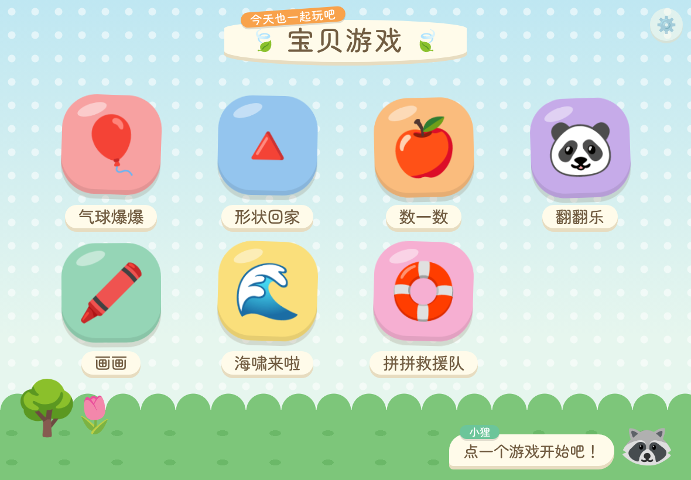

> The UI and voice are in Simplified Chinese, because the games were made for a Chinese-speaking preschooler.
> Screenshots were taken in headless Chromium, so the emoji look like Google's. On an iPad they're Apple's.

## Games

<table>
  <tr>
    <td width="50%">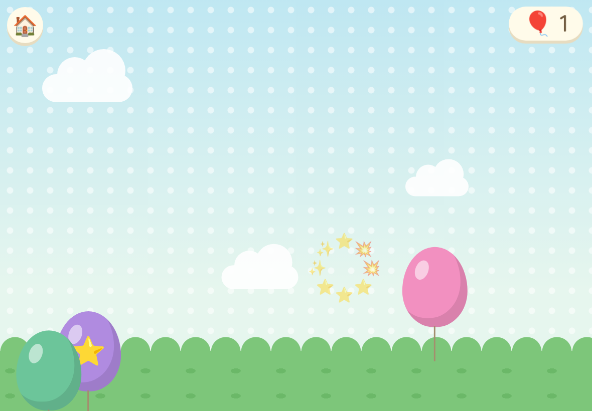</td>
    <td width="50%">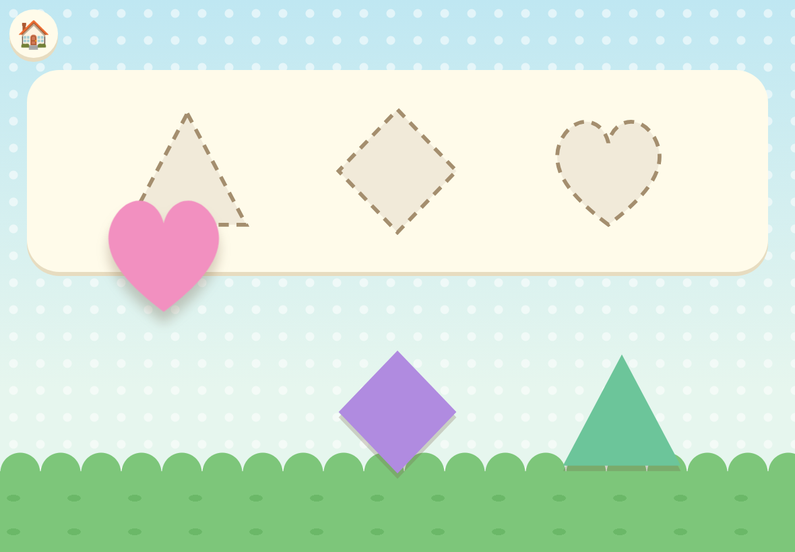</td>
  </tr>
  <tr>
    <td><b>🎈 Balloon Pop (气球爆爆)</b><br>Tap the balloons drifting up from the grass. The score is read aloud on every pop, with a cheer every 10 balloons.</td>
    <td><b>🔺 Shapes Go Home (形状回家)</b><br>Drag each shape into its dashed outline. The shape's name is spoken when you pick it up.</td>
  </tr>
  <tr>
    <td>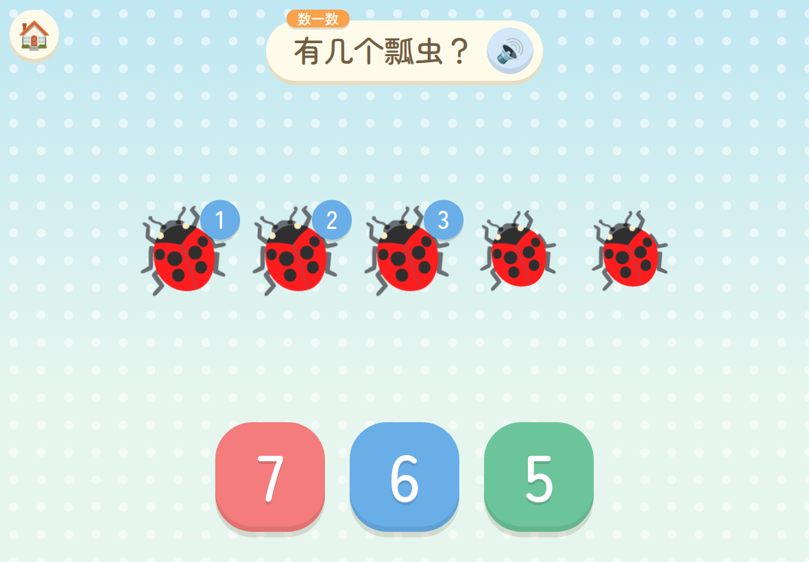</td>
    <td>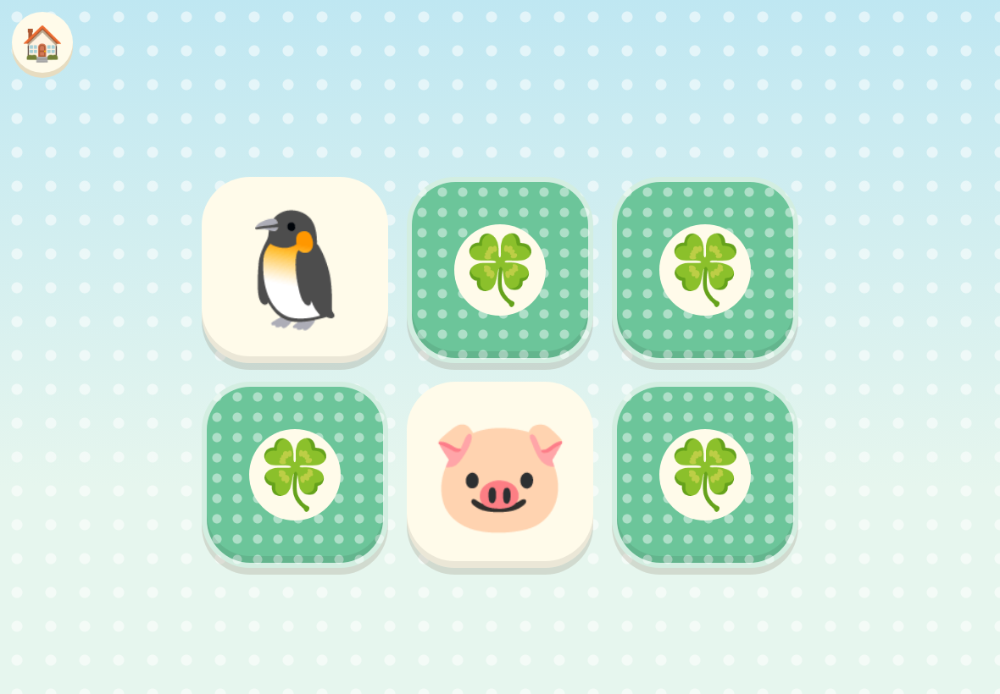</td>
  </tr>
  <tr>
    <td><b>🍎 Count Them (数一数)</b><br>"How many strawberries?" Tap each one to count it out loud, then pick the answer. The numbers get bigger as the streak grows.</td>
    <td><b>🐼 Memory (翻翻乐)</b><br>Flip the cards and find matching animals. Each animal's name is spoken. Levels go from 3 pairs up to 6.</td>
  </tr>
  <tr>
    <td>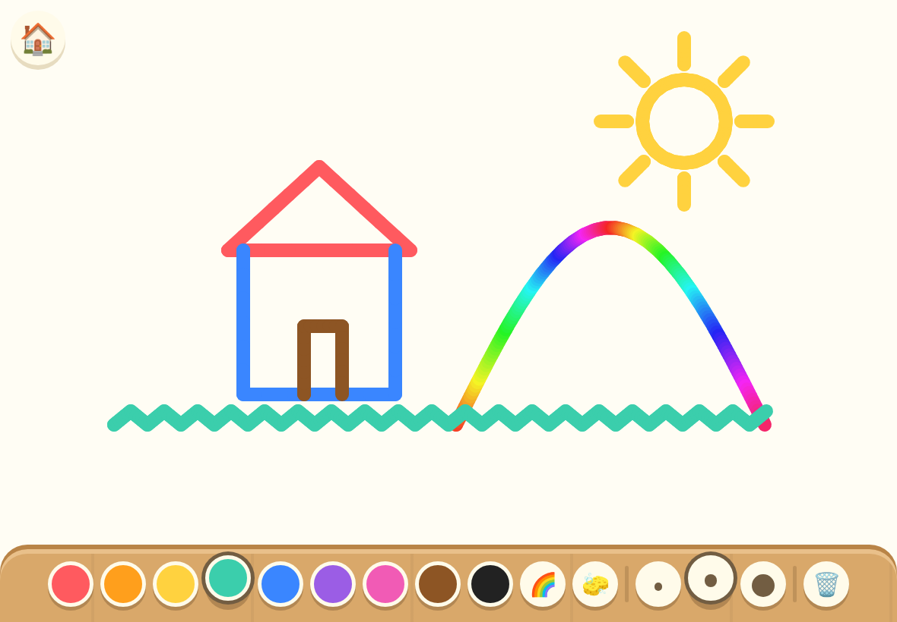</td>
    <td>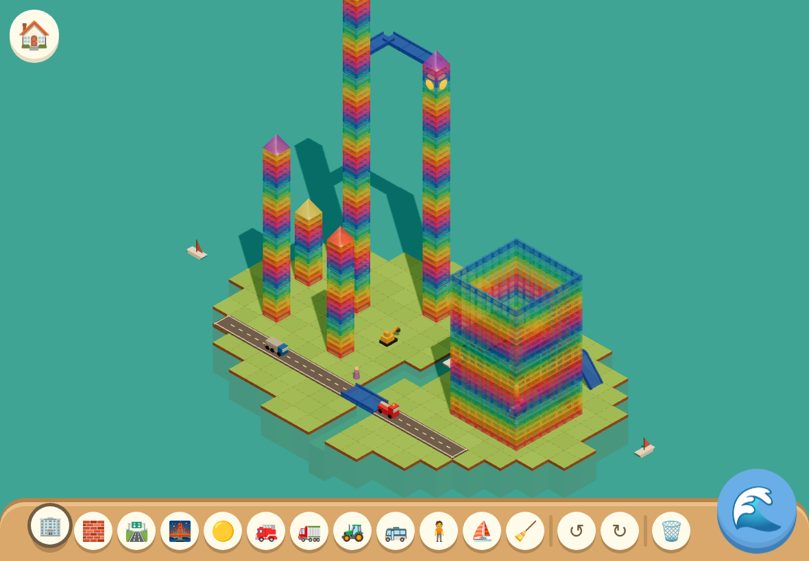</td>
  </tr>
  <tr>
    <td><b>🖍️ Drawing (画画)</b><br>Free drawing with nine colors, a rainbow pen, an eraser, three brush sizes, and multi-touch.</td>
    <td><b>🌊 Tsunami! (海啸来啦)</b><br>A 3D sandbox: build a town of magnetic-tile towers, then see whether it survives a tsunami. Details below.</td>
  </tr>
  <tr>
    <td>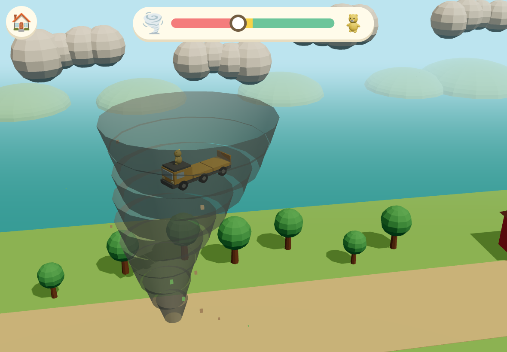</td>
    <td>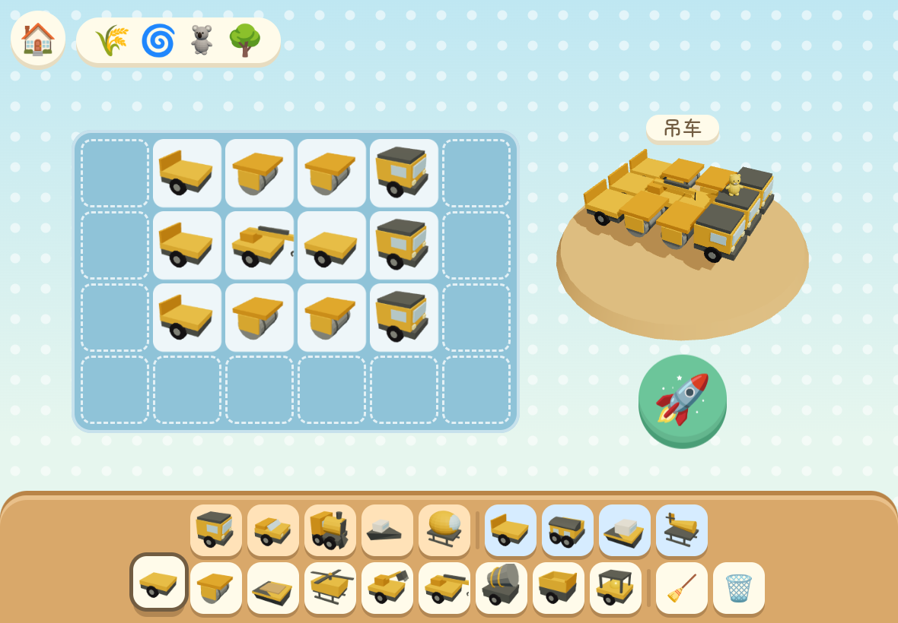</td>
  </tr>
  <tr>
    <td colspan="2"><b>🛟 Rescue Squad (拼拼救援队)</b><br>Snap magnetic parts together into a car, boat or helicopter that can ride out a tsunami, typhoon, tornado, earthquake or whirlpool, and go rescue a stranded friend. Details below.</td>
  </tr>
</table>

## 🌊 Tsunami! — the 3D sandbox

This game came from how my kid really plays: building very tall towers out of magnetic tiles
(Taipei 101 is a favorite), then rolling a rug over them as the "tsunami". Tall enough towers hold it back.

**Build**

| Tool         | What it does                                                                                                                                                                   |
| ------------ | ------------------------------------------------------------------------------------------------------------------------------------------------------------------------------ |
| 🏢 Tower     | Tap a tile to add a floor, or hold to keep stacking. The floor count is shown and read aloud. Floor 50 gets a celebration, and floor 101 turns into Taipei 101 with fireworks. |
| 🧱 Wall      | Drag across tiles to build walls, one layer per stroke. Walls join their neighbors, so you can fence things in.                                                                |
| 🛣️ Road      | Drag to paint roads. Lane markings follow turns and junctions, and roads become bridges over rivers.                                                                           |
| 🌉 Bridge    | Drag from A to B. Tower to tower makes a skybridge, tower to ground makes a ramp, and ground to ground makes a viaduct. Cars can park on bridges.                              |
| 🟡 Damper    | Add a tuned mass damper to a tower, like the golden ball inside the real Taipei 101.                                                                                           |
| 🚒🚛🚜🚌🧍⛵ | Fire trucks, car carriers, diggers, double-decker buses, people and boats.                                                                                                     |
| 🧹 / 🗑️      | Remove things one by one, or tap the bin twice to clear everything and get a new random island.                                                                                |

One finger pans the map, and two fingers pan and zoom. The island is generated at random and saved automatically.

**Then press 🌊**

A random event, a meteor, an earthquake or a volcano, sets off a tsunami 10 to 100 floors high.
The wave rolls across the island row by row:

- **Taller than the wave** — that row is blocked, and everything behind it is safe. Walls work the same way, so a ring of walls protects what's inside.
- **Lower than the wave** — towers break apart, low bridges are washed away, and cars and people float off. Boats ride the wave.
- **Earthquake** — towers above a random height fall over unless they have a damper.
- A 101-floor tower always survives, since the biggest wave is 100 floors.

<table>
  <tr>
    <td width="50%">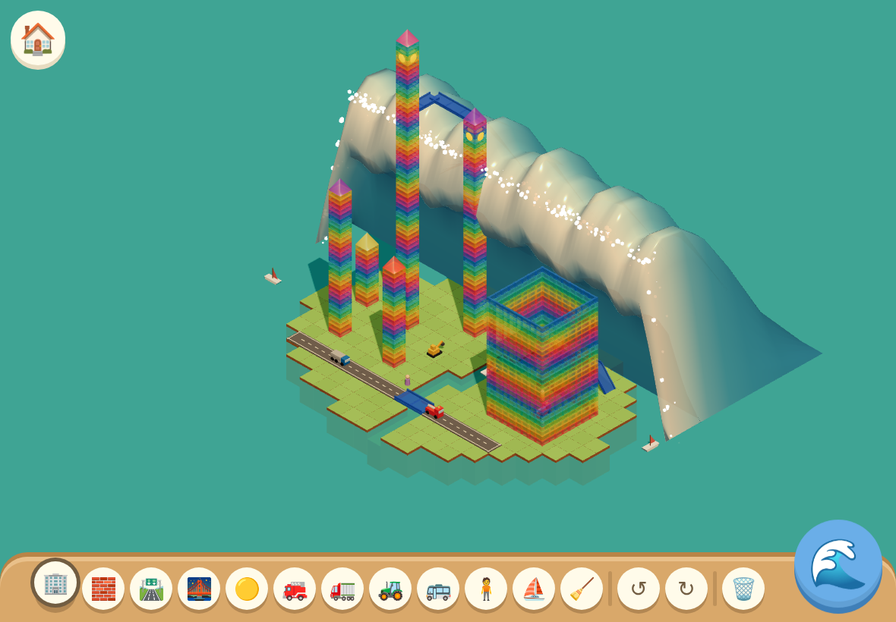</td>
    <td width="50%">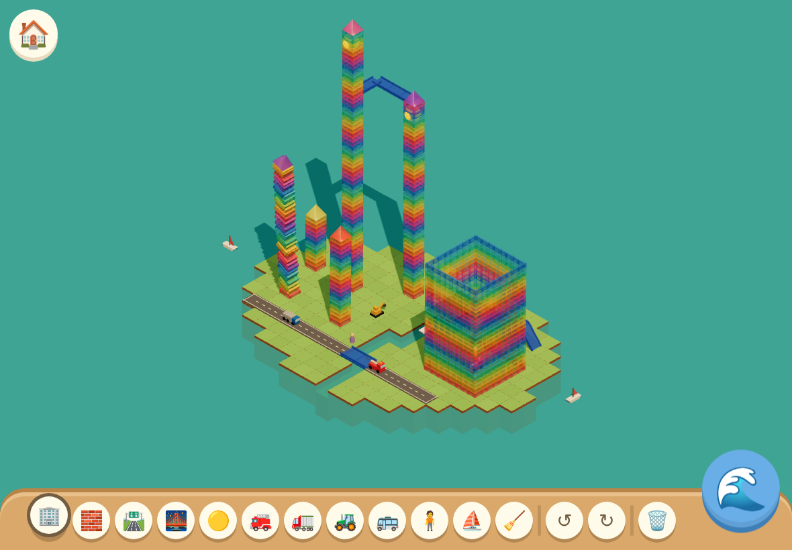</td>
  </tr>
  <tr>
    <td>A 35-floor wave. The wall ring and the taller towers block their rows.</td>
    <td>An earthquake. The tower without a damper topples, and its skybridge goes with it.</td>
  </tr>
  <tr>
    <td>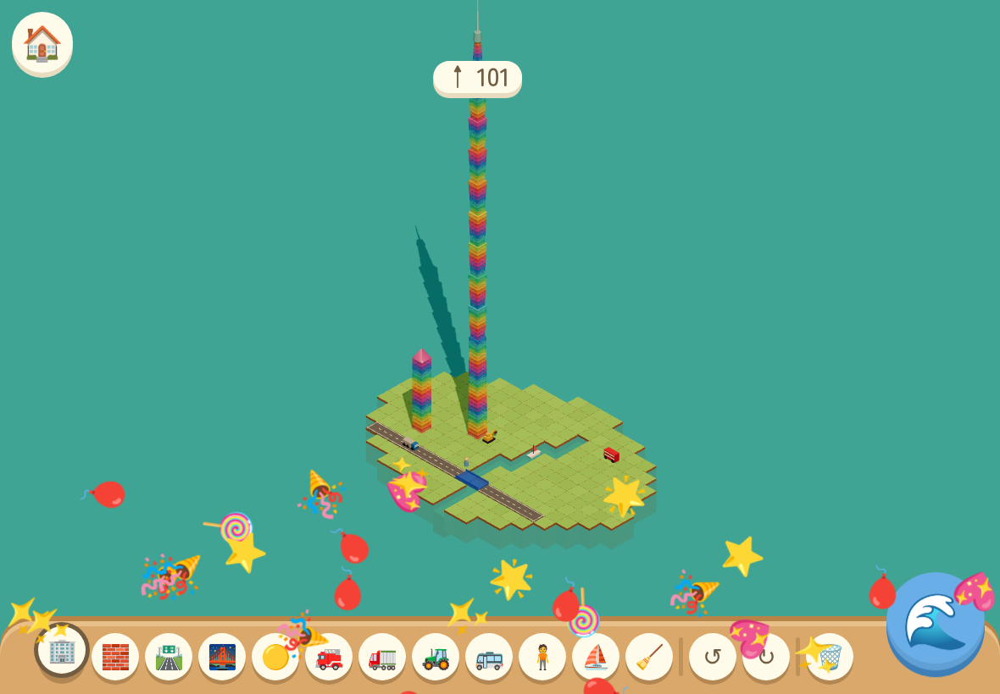</td>
    <td></td>
  </tr>
  <tr>
    <td>Floor 101: the tower turns into Taipei 101, with fireworks and confetti.</td>
    <td>Skybridge, ramp, viaduct, a walled yard, roads and boats.</td>
  </tr>
</table>

## 🛟 Rescue Squad — build a vehicle that survives the disaster

This one is based on a set of magnetic transforming construction trucks my kid has: the heads, middle sections and tails all come apart and snap together in any order.
In the game, Captain Yellow Bear (modeled on the kid's favorite plush) builds a rescue vehicle out of those parts, crosses land or sea, rides out a disaster,
and brings back a stranded koala, chick or polar bear.

Like Tsunami!, every disaster maps to a real physical idea, and no vehicle wins everything:
heavy things don't blow over, but they also sink and can't fly.

**Build**

- A 6×4 grid and 18 parts: 5 heads, 9 middle sections and 4 tails. Every part brings its own bottom: wheels, a road roller, a hull, or helicopter skids.
- Tap to place a part, or drag to lay down a row. You need a head and a tail, everything has to be connected, and nothing can go in front of a head or behind a tail.
- Tap a placed dump-truck bed again to load it with rocks and make it heavier.
- The turntable on the right shows the vehicle in 3D and says what it is: car, crane, boat, amphibious truck, flying car…
- The garage remembers the last 6 vehicles you set off in.

**Go!**

| Disaster                 | The idea                                                                         | Ways to build for it                                                        |
| ------------------------ | -------------------------------------------------------------------------------- | --------------------------------------------------------------------------- |
| 🌊 Tsunami               | Float, and you ride over the wave                                                | A hull, or fly over with rotors                                             |
| ⛈️ Typhoon               | Heavy and wide doesn't tip; a raised crane boom or a helicopter catches the wind | A wide base with rollers or a mixer; a wide boat                            |
| 🌪️ Tornado               | Hold on to the ground                                                            | Dig the excavator bucket in, hook the crane to the ground, or just be heavy |
| 🫨 Earthquake            | Long enough to span the crack; low, wide or damped doesn't shake over            | A long vehicle, a wide base, the damper ball                                |
| 🌀 Whirlpool (free mode) | A long boat lies across the whirlpool and doesn't get sucked in                  | More hull pieces in a row; or fly over                                      |

Some rules hold everywhere: wheels on land; a hull on water, with enough buoyancy for the weight (too heavy and it sinks);
rotors only lift off if their lift beats the weight; and a friend up a tree or on a roof needs a crane to reach.

During the disaster a tug-of-war bar shows the disaster's strength on the left and the bear on the right. Whichever way the knot moves is winning.

**10 missions plus free play**, from "drive across the meadow to pick up the koala" to "rescue the polar bear from a roof during a big earthquake".
Free play rolls a random terrain, disaster and friend.

**Failing is fun too.** Vehicles tip over, get sucked into the tornado (and float down under a little umbrella), or sink (and the bear climbs into a life ring). Nothing is scary.
When the same thing goes wrong again, the hints get stronger:

1. The first time, it just says what happened: "The wind blew the truck over!"
2. The second time, it asks an everyday question: "Can the wind move a leaf? What about a big rock?"
3. The third time, the result card shows 💡 with the parts to try, and those parts bounce and glow in the tray.

Each rescue earns a sticker for the idea it used (10 in all: wheels, hull, lift, heavy, low, grip, long, wide, balance, damper), and rescued friends show up on the friends board on the map.

<table>
  <tr>
    <td width="50%">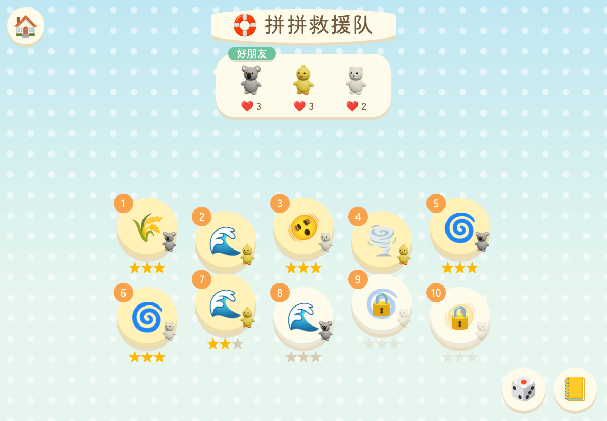</td>
    <td width="50%">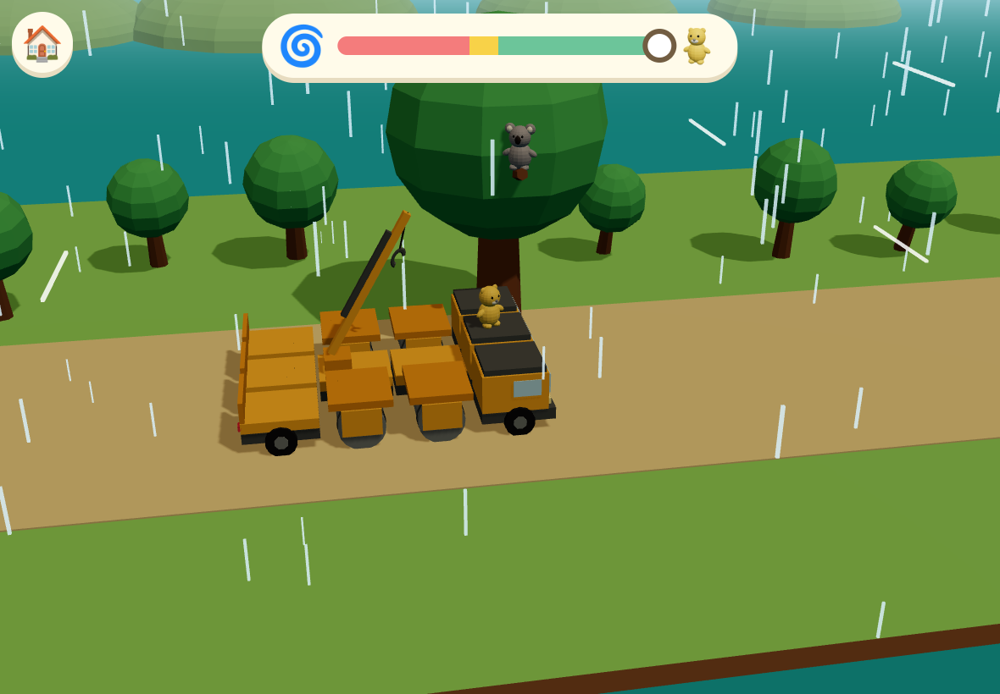</td>
  </tr>
  <tr>
    <td>The mission map, the friends board and the sticker book.</td>
    <td>Lifting the koala out of a tree in a typhoon. Road rollers on both sides make the crane wide and heavy enough not to tip.</td>
  </tr>
  <tr>
    <td>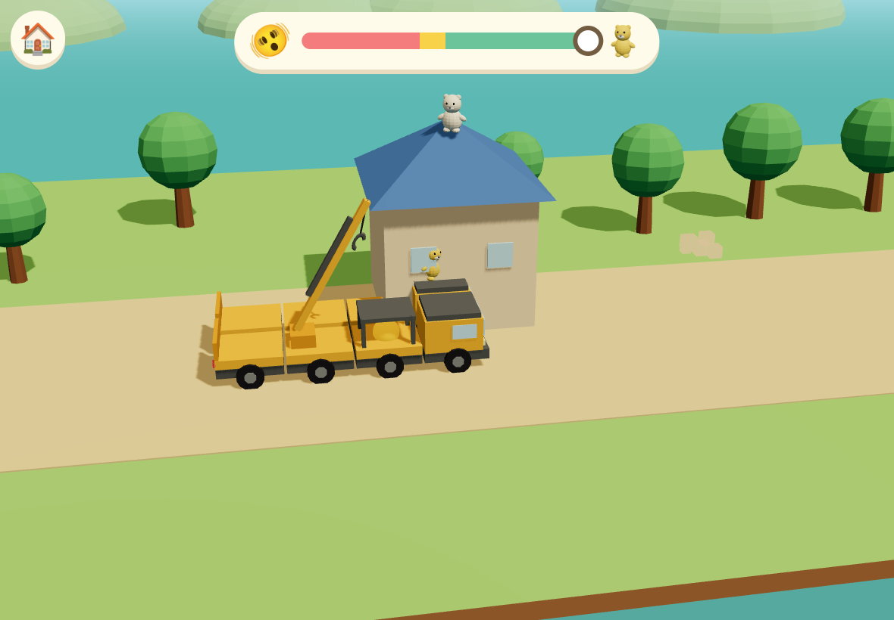</td>
    <td>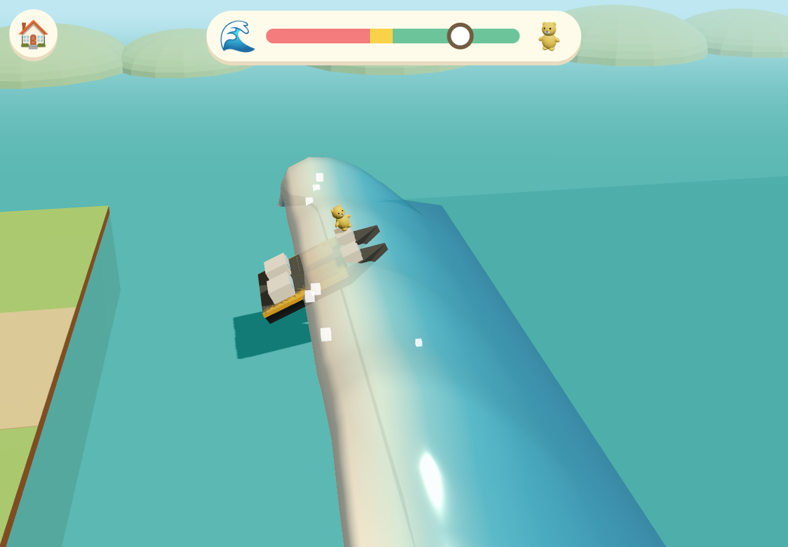</td>
  </tr>
  <tr>
    <td>Rescuing the polar bear from a roof in a big earthquake. The damper ball soaks up the shaking and the boom telescopes up to the roof.</td>
    <td>A two-wide boat riding up the face of the tsunami.</td>
  </tr>
</table>

Part stats live in `src/app/games/rescue/parts.ts` and the rules in `sim.ts`. After changing them, run `npm run test:rescue`:
it checks that every mission is still solvable and that the typical mistakes still fail. The full design is in [docs/rescue-design.md](docs/rescue-design.md) (in Chinese).

## For parents

Hold the ⚙️ in the top-right corner of the menu for 1.5 seconds, then answer a multiplication question.
Little kids can't open the settings by accident.

<table>
  <tr>
    <td width="33%">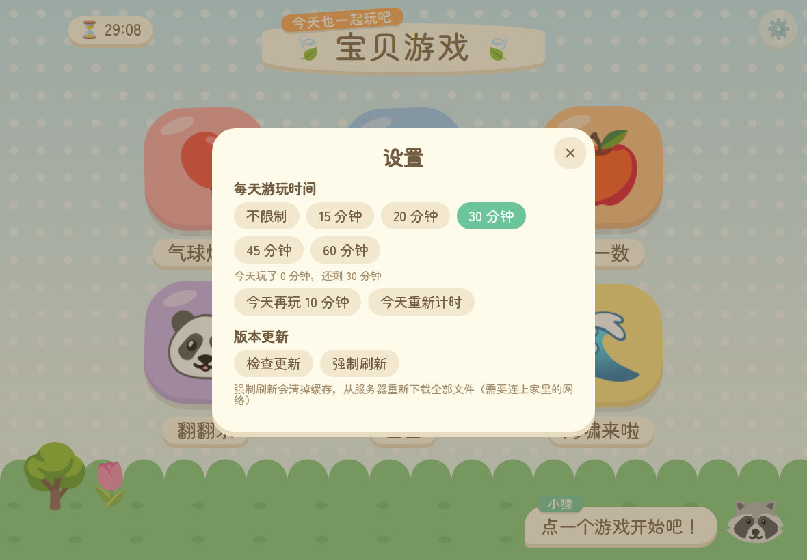</td>
    <td width="33%">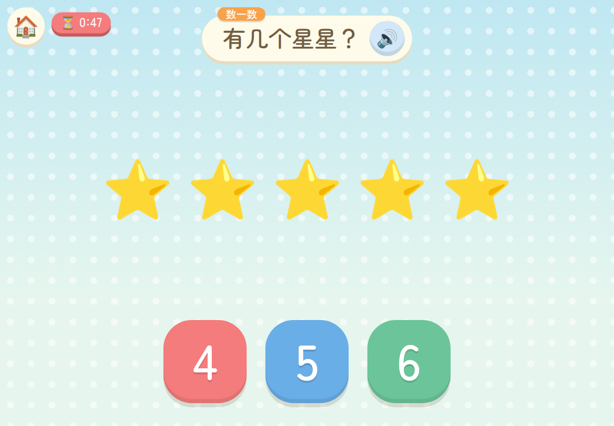</td>
    <td width="33%">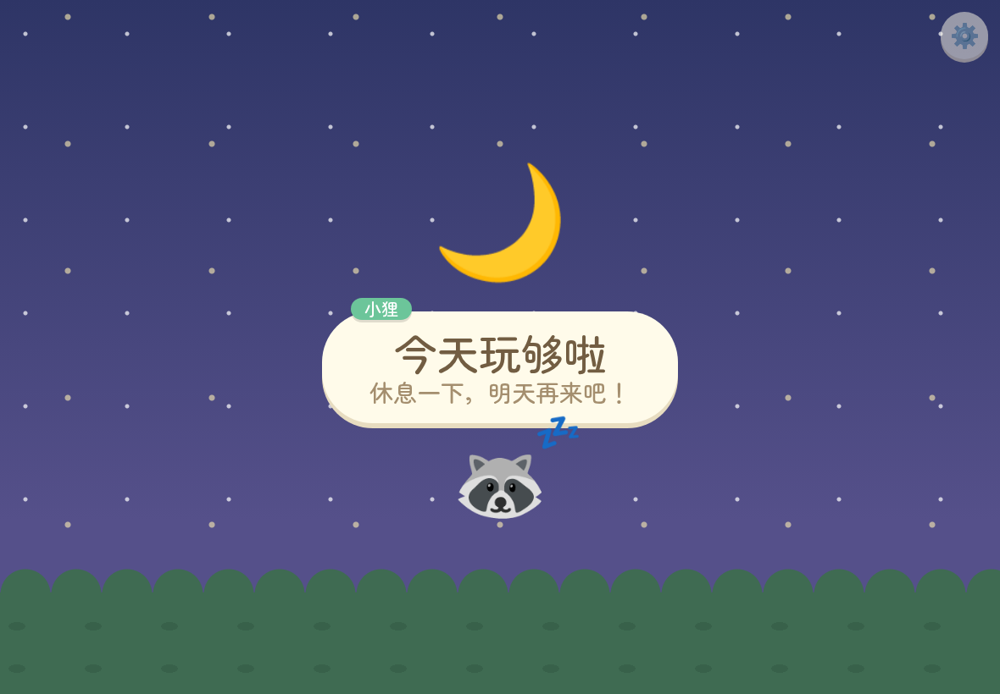</td>
  </tr>
  <tr>
    <td>Daily limit, extra time, update check and force refresh.</td>
    <td>The countdown turns red in the last minute, with a spoken reminder.</td>
    <td>When time is up, a bedtime screen covers everything until tomorrow.</td>
  </tr>
</table>

- **Daily play limit**: off, or 15 to 60 minutes. Time only counts while a game is on screen. The menu and background don't count.
- **Check for update / force refresh**: force refresh unregisters the service worker and clears the caches. It first checks that the server is reachable, so you can't end up with a blank app while offline.
- **Updates never interrupt a game**: a new version downloads in the background and applies when the kid goes back to the menu.

## Tech

- **Angular 22** with standalone components and signals. Each game is lazy-loaded.
- **three.js**:
  - Tsunami!: an orthographic isometric camera, instanced meshes for the tiles, a hand-rolled curling wave mesh, and simple ballistic and buoyancy "physics".
  - Rescue Squad: a perspective camera that follows the vehicle. Every part and plush is built from primitives in code, and the tray icons are rendered with three.js at startup. It shares the wave mesh with Tsunami!.
- **PWA** with `@angular/service-worker`. Everything is precached, including voice clips and the font, so it works offline after the first visit.
- **Voice**: about 490 lines pre-rendered as MP3 with Microsoft's neural voices through [edge-tts](https://github.com/rany2/edge-tts). Xiaoxiao reads normal lines, the livelier Xiaoyi reads praise, and Captain Yellow Bear in Rescue Squad uses the child voice Yunxia. Clips play through Web Audio, so iOS doesn't block delayed playback. If a clip is missing, the system TTS is used instead.
- **Sound effects** are synthesized with Web Audio, with no audio files.
- **Font**: ChillRound (寒蝉圆黑体), subset to the roughly 1,000 characters the app uses (about 160 KB) and renamed as the OFL requires.

## Getting started

Requires Node.js 22+. Python 3 is only needed to regenerate voice clips or the font subset.

```bash
npm install
npm start                 # dev server at http://localhost:4200
npm run build             # production build in dist/kids-games/browser
npm run test:rescue       # rule tests for Rescue Squad
```

The voice clips and font subset are committed, so you only need these when you change text:

```bash
npm run tools:setup       # once: creates .venv with edge-tts, fonttools and brotli
npm run voice             # generate missing clips, delete unused ones, update voice-files.ts
npm run font              # re-subset the font after adding new Chinese characters
```

### Deploying

Any static HTTPS host works. Routing uses `#/`, so no SPA fallback rule is needed. The service worker needs HTTPS (or `localhost`).

My setup: `npm run deploy` builds and `rsync`s the output to a folder that Synology Drive syncs to a NAS,
where Web Station serves it over HTTPS. Set `DEPLOY_DIR` to choose the target folder:

```bash
DEPLOY_DIR=/path/to/site npm run deploy
```

## Project structure

```
src/app/
  games.ts            game registry: the menu and routes are generated from this
  voice-lines.ts      every line the app speaks (input for npm run voice)
  core/               sound, speech, celebration, play-time limit, app updates
  shared/             game shell (home button + start screen), settings, rest screen, countdown
  menu/               main menu
  games/<name>/       one folder per game; <name>-data.ts holds the data and spoken lines
  games/tsunami/      world.ts (scene, input, wave, quake), camera-rig.ts, wave-mesh.ts,
                      island.ts (random islands), models.ts (low-poly vehicles and bridges)
  games/rescue/       parts.ts (part stats), vehicle.ts (assembly rules), sim.ts (outcomes),
                      journey.ts (the trip and the disasters), preview.ts (turntable), models.ts
public/voice/         pre-rendered MP3s
public/fonts/         font subset
scripts/              gen-voice.mts, subset-font.py, deploy.sh
```

### Adding a game

1. Create `src/app/games/<name>/<name>.ts`, plus `.html` and `.scss`, and wrap the template in `<app-game-shell (start)="start()">`.
2. Add an entry to `GAMES` in `src/app/games.ts`: path, title, emoji, color, intro line and lazy loader.
3. Put the spoken lines in `<name>-data.ts`, add them to `src/app/voice-lines.ts`, then run `npm run voice`.

The menu, routing and offline cache pick up the new game automatically.

## Credits & licenses

- Code: [MIT](LICENSE).
- Font: [ChillRound](https://github.com/Warren2060/ChillRound) by ChillType, under the SIL Open Font License 1.1 ([licenses/ChillRound-OFL.txt](licenses/ChillRound-OFL.txt)). The bundled file is a modified subset, renamed to _KidsGamesRound_ as the OFL's Reserved Font Name clause requires.
- Voice clips: generated with Microsoft's online neural TTS through the unofficial edge-tts client. Check Microsoft's terms before reusing them.
- [three.js](https://threejs.org/) (MIT) and [Angular](https://angular.dev/) (MIT).
- Art direction is inspired by _Animal Crossing_ (UI) and _Bastion_ (the island that assembles from falling tiles). No assets from either game are used.
